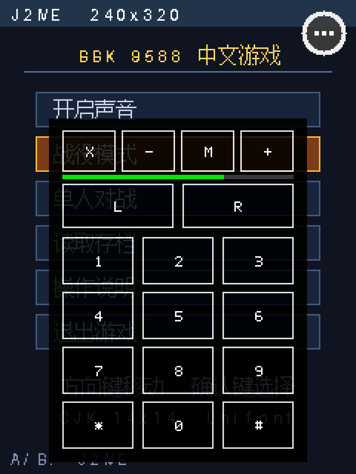
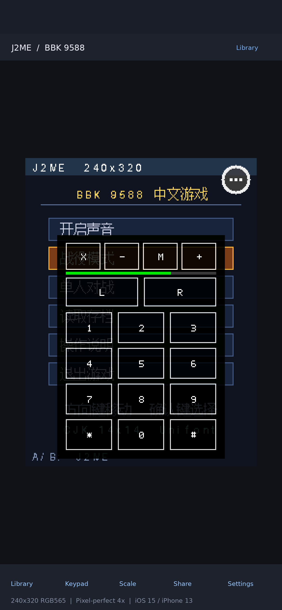

# BBK 9588 J2ME · iOS 移植

把 [HelloClyde/BBK9588-J2ME](https://github.com/HelloClyde/BBK9588-J2ME) 的
phoneME/KVM J2ME 运行时移植到 iOS，目标 **iOS 15.0+ / iPhone 13**，
用 **GitHub Actions 编译**，全程不需要 Mac。

原项目是跑在步步高 9588 学习机上的 **裸机 MIPS BDA 应用**：Java 画面以
RGB565 直接写入固件 framebuffer（240×320），触摸与实体键读固件原始输入，
动态内存硬限 6 MiB。本工程保留这套行为模型，只把「固件」换成 iOS 对应的服务。

## 运行预览

下面是平台层在 Linux 上用**原项目真实 CJK 字库**渲染出的 240×320 RGB565 画面
（3 倍最近邻放大），软键盘、悬浮点、音量条与 9588 真机保持同一套绘制算法：



在 iPhone 13 竖屏上按默认「像素完美」模式使用 4× 整数倍缩放的构图：



> 这两张图来自本地端到端渲染验证，不是概念示意图；但它们展示的是**诊断内核**
> 的界面。phoneME 内核接通后，同一套缩放/软键盘框架会显示真实游戏画面。

---

## 先说清楚现状（重要）

这个移植分两层，**两层都在仓库里，但成熟度不同**：

| 层 | 内容 | 状态 |
| --- | --- | --- |
| **App / 平台层** | UIKit 壳、240×320 RGB565 缩放显示、悬浮点+半透明软键盘+音量条、触控映射、JAR 导入、CJK 字库、MMAPI 音频链路、RMS 目录 | ✅ 完整实现，并在 Linux 上用真实 CJK 字库端到端跑通渲染（中文、按键、事件队列、ZIP 规范化） |
| **诊断内核（默认）** | 不执行 Java，但把除「KVM 解释执行」外的每一条链路都真跑一遍 | ✅ 默认编译目标，CI 第一次运行就能产出**可安装、可点、可验证缩放**的 IPA |
| **phoneME 内核** | 从上游源码 + 原补丁重新 romize 并编译成 `arm64-apple-ios` 静态库 | ⚠️ 脚本与 iOS 适配层已备齐，但**必须在 macOS runner 上迭代**；CI 设了自动降级，失败不影响出包 |

为什么 phoneME 不能直接搬：原仓库 `third_party/phoneme/prebuilt/*.a` 是
**MIPS32 ELF 目标码**，其中 `ROMImage.o` 是 romize 后的 Java 类库，内部是
32 位 MIPS 重定位。iOS 是 arm64 / Mach-O，指针宽度与 ABI 都不同，
**必须重新生成 ROMImage 并重编译全部 C/C++ 源码**。详见
[`docs/KERNEL_STATUS.md`](docs/KERNEL_STATUS.md) 与
[`scripts/ios-kernel-overlay/README.md`](scripts/ios-kernel-overlay/README.md)。

我无法在这个 Linux 沙箱里验证 Xcode 编译，所以没有把「内核已跑通」写成既成事实。
但工程被设计成**分阶段可验证**：先让你在 iPhone 13 上看到画面、摸到缩放和软键盘，
再按 Actions 日志把内核接上。App 层代码在两种内核下完全不用改（共用 `j2me_kernel.h` ABI）。

---

## 三步上手（只需要 GitHub 账号 + iPhone）

1. **把工程传到你的 GitHub 仓库**（建议设为 Public，公开仓库的
   macOS runner 免费；私有仓库按 10× 分钟扣额度）。
   **只有手机、没有电脑**看 [`docs/UPLOAD.md`](docs/UPLOAD.md)：只需上传
   `BBK9588-J2ME-iOS.zip` + 粘贴 **20 行**引导 workflow，Actions 会自动把全部
   85 个文件铺好并开始编译；有电脑则直接 `git push` 整个目录。
2. 打开 **Actions → iOS 构建（iPhone 13 / iOS 15+）→ Run workflow**。
   默认 `kernel_backend=mock`，几分钟后下载 artifact `J2ME-iOS-IPA` 里的
   `J2ME-unsigned.ipa`。
3. 按 [`docs/INSTALL.md`](docs/INSTALL.md) 把 IPA 装到 iPhone 13
   （iOS 15 下最省事的是 TrollStore，其它版本用手机端签名工具或证书签名）。

装好之后：
- 点右上角**白色悬浮点**展开/收起软键盘（和原项目一样，拖动超过 12px 可移动）。
- 顶部 `X` 弹出「是/否」退出确认，`-` / `+` 每次调 10% 主音量，`M` 静音。
- 从「文件」App 把 `.jar` **共享到本 App**，或在 App 内点「选游戏 → +」导入；
  会自动解析 `META-INF/MANIFEST.MF` 的 `MIDlet-1`（兼容混淆类名）。
- 工具栏「缩放」循环切换三种模式；设置里可切换最近邻/平滑插值。

---

## 针对 iPhone 13 的显示优化

原项目是 240×320（3:4）固定物理 framebuffer。iOS 版保持 **逻辑坐标永远是
240×320**，只在最后一环做缩放，因此 C 层的软键盘命中测试、CJK 绘制一个字节都不用改：

| 模式 | 行为 | iPhone 13 竖屏效果 |
| --- | --- | --- |
| **像素完美**（默认） | `floor(min(可用宽/240, 可用高/320))` 整数倍 + 最近邻 | 通常 **4× = 960×1280 px**，像素边缘锐利，最接近 9588 真机 |
| 等比适配 | 浮点等比缩放到可用区域 | 画面更大，可有非整数倍缩放 |
| 拉伸填满 | 铺满可用区域 | 会改变 3:4 比例，一般不用 |

- 插值可选**最近邻 / 双线性**，针对高分屏可切换观感。
- 像素完美在 iPhone 13 竖屏是 **4×**，上下会留黑边（整数倍的固有结果，
  最贴近真机）；想让画面更大可切到「等比适配」（约 4.875×，铺满宽度）。
- 竖屏上下用原生 UIKit 工具栏（选游戏 / 键盘 / 缩放 / 截图 / 设置），
  **横屏自动进入沉浸式全屏**并隐藏状态栏。
- 遵守 `safeAreaInsets`（刘海、底部 Home Indicator），画面不会被遮挡。
- 支持外接键盘 / 手柄：方向键、WASD、数字键、`*` `#`、空格/回车映射到 MIDP 键码。

软键盘本身**不是**用 UIKit 重画的，而是沿用原项目在 RGB565 framebuffer 上
做 alpha 合成的算法与几何常量（`PANEL_X=33 / WIDTH=174 / HEIGHT=232`、
底板 `224/256`、按键 `208/256`、5×7 标签字形、绿色音量条），
所以放大后与 9588 真机画面一致。

---

## 保持「原汁原味」的部分

| 原项目 | iOS 版 |
| --- | --- |
| 240×320 RGB565 framebuffer | 同尺寸同像素格式的内存 surface + 缩放提交 |
| 14×14 CJK 点阵（28,400 字形 / 766,812 字节） | **同一个二进制文件**，同一套二分查找与可变宽度算法 |
| 西文 9×14 advance | 保留 9px advance / 14px 行高 |
| 悬浮点（直径 31px、热区 44×44、拖动阈值 12px） | 完全相同的常量与合成规则 |
| 深色半透明软键盘 `L/R/1-9/*0#`、X/-/+/M、音量条 | 相同键位布局与 5×7 标签字形 |
| 32 深事件队列、move 合并、关键按下/抬起不丢 | `native_events.c` 语义原样移植 |
| `META-INF/MANIFEST.MF` 自动发现 `MIDlet-1` | 相同解析逻辑（含旧 ZIP data descriptor 规范化） |
| RMS / appdb / `J2MEPHONE.LOG` 目录布局 | `Documents/J2ME/`（游戏）+ `Application Support/J2ME/{rms,appdb}`（数据） |
| MMAPI：MIDI SMF 0/1、PCM WAV、`playTone`、22kHz/16bit/mono | 上游 `phoneme_audio.c` 原样编译，只换 7 个固件 shim |
| 3 MiB Java heap / 6 MiB 分配上限 | 保持默认配置值 |

原项目里与 BBK 固件耦合的部分（`bda_gui_*`、`bda_audio`、GBK 路径、
freestanding libc、MIPS 汇编、objcopy 嵌入资源）被替换成 UIKit /
AudioQueue / POSIX / libSystem，逐项对照见 [`docs/PORTING.md`](docs/PORTING.md)。

---

## 目录

```
.github/workflows/     ios.yml（主构建） / ios-release.yml（tag 发布）
scripts/               bootstrap / 内核编译 / App 编译 / IPA 打包与签名
  ios-kernel-overlay/  phoneME 的 iOS 平台适配层与兼容 shim
ios/
  project.yml          XcodeGen 工程定义（不提交 .xcodeproj）
  Info.plist           iOS 15 部署、文件共享、.jar UTI
  App/                 UIKit 壳、缩放视图、JAR 库、设置、内核桥
  Platform/            RGB565 framebuffer / 事件 / CJK / JAR / 软键盘 / 音频 / 时钟
  Kernel/Mock/         诊断内核（默认）
  Kernel/PhoneME/      phoneME 内核 ABI 转发
  Resources/           原项目的 CJK 字库、skin、图标
vendor/                原项目源码与补丁（只读参考，保持原样）
docs/                  UPLOAD / PORTING / BUILD / INSTALL / KERNEL_STATUS / LEGAL
  bootstrap-mini.yml      手机上传用的 20 行引导 workflow 模板（推荐）
  bootstrap-workflow.yml  52 行详细版，功能相同
```

---

## 许可证

原创代码 **GPL-2.0-only**（与上游一致）；phoneME 保留 Sun 的 GPL-2.0-only
文件头；CJK 字库来自 GNU Unifont，按 **SIL OFL 1.1** 分发。
完整归属见 [`NOTICE.md`](NOTICE.md) 与 [`docs/LEGAL.md`](docs/LEGAL.md)。
随 Release 提供完整对应源码 ZIP。

本项目是非官方社区移植，与步步高、Oracle、各游戏厂商无隶属或授权关系。
**请只导入你合法持有的游戏 JAR。**
